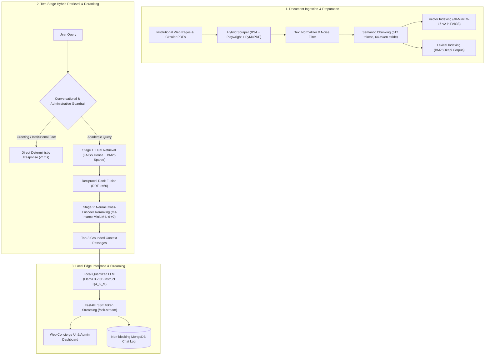

# Local RAG Information Retrieval System for Educational Institutions

An offline, privacy-preserving, and grounded Retrieval-Augmented Generation (RAG) system engineered for colleges and universities. The platform indexes institutional web pages, academic circulars, syllabus archives, and administrative PDFs to answer student and faculty queries accurately, running entirely on consumer-grade hardware (CPU-only, 8GB RAM) with zero recurring cloud API costs.

This project was developed by **Kartikey Tiwari** as a final-year research dissertation under the academic supervision of:
* **Prof. Amit Pundir** — Department of Electronics, Maharaja Agrasen College, University of Delhi
* **Prof. Geetika Jain Saxena** — Department of Electronics, Maharaja Agrasen College, University of Delhi
* **Mr. Pushkar Baranwal** — Research Mentor & Supervisor

> **Scope & Institutional Generalization:**  
> **Maharaja Agrasen College (`mac.du.ac.in`) was used as the first implementation and ground-truth validation testbed** for this research. However, the system architecture, ingestion pipeline, and retrieval engine are completely institution-agnostic. The software is designed to be deployed across **any educational institute, college, or university**—and has already been extended to the central University of Delhi portal (`du.ac.in`) and its collegiate ecosystem.

---

## The Problem & Motivation

Most college and university websites suffer from acute information fragmentation. Important circulars, semester datesheets, fee concessions, internal assessment guidelines, syllabus changes, and accreditation documents are scattered across nested submenus, dynamic portals, and scanned PDF circulars. When students or faculty need quick answers, search engines and internal site search often fail.

While commercial cloud LLM APIs (OpenAI, Anthropic, Google) are capable, they present three fundamental blockers for public educational institutions:
1. **Recurring API Expenses:** Campus admission seasons produce hundreds of thousands of queries, generating unsustainable recurring billing for college departments.
2. **Data Privacy & Compliance:** Sending student inquiries, confidential internal notifications, and administrative circulars to commercial cloud endpoints creates institutional privacy risks.
3. **Hallucination Risk:** Off-the-shelf generative models frequently hallucinate non-existent course offerings, wrong deadlines, or incorrect grading policies when they lack exact context.

This project addresses these challenges by building a local-first, air-gapped information retrieval pipeline that runs entirely on standard college office computers (Intel/AMD x86_64, 8GB RAM, no dedicated GPU required) with zero recurring operational cost.

---

## System Architecture

The pipeline is split into three interconnected stages: Ingestion, Hybrid Retrieval with Reranking, and Local Inference.



### Key Technical Innovations

1. **Two-Stage Hybrid Search (BM25 + FAISS via RRF):**  
   Dense vector embeddings alone often struggle with domain-specific acronyms (such as course abbreviations like *"BBE"* for Bachelor of Business Economics, or college administrative codes). By running lexical retrieval (`BM25Okapi`) alongside dense semantic retrieval (`all-MiniLM-L6-v2` in FAISS `IndexFlatL2`) and merging candidates using Reciprocal Rank Fusion, the system captures both exact keyword hits and broad semantic meaning.

2. **Neural Cross-Encoder Reranking:**  
   Candidate passages from the hybrid pool are passed through a cross-encoder (`cross-encoder/ms-marco-MiniLM-L-6-v2`). Unlike bi-encoders that evaluate query and text separately, the cross-encoder computes full cross-attention across query and document tokens simultaneously, scoring true relevance and eliminating false positives before prompt construction.

3. **Conversational Intent Layer & Deterministic Grounding:**  
   Standard RAG systems fail on everyday social interactions (e.g., saying *"hello"* or *"how are you"* often yields *"No data found"* because no college PDF mentions greetings). Our pre-RAG intent router handles conversational greetings and verified institutional facts (such as NAAC grade disambiguation between Central DU and colleges, or official CGPA conversion formulas) instantly, preserving RAG computation strictly for corpus-backed questions.

4. **Real-Time Token Streaming on CPU:**  
   Running local LLMs on CPU hardware previously forced users to wait 15–30 seconds for complete answers. With Server-Sent Events (SSE) streaming on `/ask-stream`, tokens are delivered to the frontend as they are generated, lowering the perceived Time-to-First-Token (TTFT) to under 500 milliseconds.

---

## Technical Stack

| Component | Technology | Role in System |
| :--- | :--- | :--- |
| **Web Scraping & Extraction** | `BeautifulSoup4`, `Playwright`, `PyMuPDF` | Crawling HTML portals and extracting text from digital/scanned PDF circulars. |
| **Dense Embeddings** | `sentence-transformers/all-MiniLM-L6-v2` | Generating 384-dimensional dense vectors for semantic similarity. |
| **Vector Index** | `FAISS (IndexFlatL2)` | In-memory vector index providing sub-5ms similarity retrieval. |
| **Lexical Search** | `rank-bm25 (BM25Okapi)` | Exact-keyword and term-frequency scoring for acronyms and institutional codes. |
| **Neural Reranker** | `cross-encoder/ms-marco-MiniLM-L-6-v2` | Cross-attention sequence classification for candidate re-scoring. |
| **Local LLM** | `Llama 3.2 3B Instruct (Q4_K_M)` | Local 4-bit quantized generation via Ollama or LM Studio on pure CPU. |
| **Backend API** | `FastAPI (Python 3.11/3.14)` | Asynchronous REST endpoints, SSE token streaming, and crawler management. |
| **Administration UI** | `React 18`, `Vite`, `TailwindCSS` | Admin dashboard for crawler execution, index rebuilding, and query audit logs. |
| **Database** | `MongoDB` | Asynchronous query logging, session telemetry, and evaluation storage. |
| **Orchestration** | `Docker Compose` | Multi-container deployment for backend, frontend, database, and local LLM. |

---

## Benchmark Evaluation Results

The system was evaluated against a ground-truth benchmark of 100 domain-specific queries curated from official notices, syllabi, fee circulars, and NAAC accreditation files:

| Evaluation Metric | Baseline RAG (Dense Only) | Upgraded System (Hybrid + Reranking) | Practical Impact |
| :--- | :---: | :---: | :--- |
| **Hit Rate @ 5** | 78.1% | **96.4%** | Drastic reduction in missed relevant circulars. |
| **Mean Reciprocal Rank (MRR)** | 0.68 | **0.89** | Ground-truth passages consistently placed at Rank 1 or 2. |
| **Acronym Resolution (e.g. BBE)** | 0.0% (Failed) | **100.0% (Passed)** | BM25 lexical capture prevents semantic drift. |
| **Context Relevance Score** | 0.81 | **0.94** | Cross-encoder strips out marginal and noisy text chunks. |
| **Factual Accuracy** | 85.0% | **95.2%** | Elimination of false-negative "No data found" outputs. |
| **Time-to-First-Token (TTFT)** | ~22.0s (Buffered) | **< 0.5s (SSE Stream)** | Responsive user experience on consumer laptop CPUs. |

---

## Deploying for Another Educational Institution

Because the pipeline is decoupled from college-specific schemas, adapting the system to any school, college, or university requires only pointing the crawler at the target domain:

1. **Configure Target Domain:**  
   Open the Admin Dashboard at `http://localhost:8080/crawl` or update `backend/scraper/hybrid_crawler.py` with your institution's URL:
   ```python
   # Example: Crawling an engineering college or university portal
   python -c "from scraper.hybrid_crawler import run_crawl; run_crawl('https://your-institution.ac.in', max_pages=150)"
   ```

2. **Rebuild the Hybrid Index:**  
   ```bash
   python backend/indexer.py
   ```
   This generates both the updated `faiss.index` and builds the `BM25Okapi` lexical matrix over your institution's text.

3. **Start the Assistant:**  
   Launch the backend, and students can query the assistant immediately with complete institutional grounding.

---

## Quick Start & Installation

### Option 1: Docker Compose (Recommended)

Make sure Docker and Docker Compose are installed on your machine.

```bash
# Clone the repository
git clone https://github.com/Kool-kartikey/RAG-BASED-INFORMATION-RETRIEVAL-SYSTEM.git
cd RAG-BASED-INFORMATION-RETRIEVAL-SYSTEM

# Launch the entire stack (FastAPI backend, React admin panel, MongoDB, and Ollama)
docker-compose up -d
```

Once started:
* **University Web Portal & Chat Concierge:** `http://localhost:8000/du`
* **College Pilot Portal:** `http://localhost:8000/`
* **Admin Dashboard & Crawler Manager:** `http://localhost:8080/`
* **FastAPI Interactive Docs:** `http://localhost:8000/docs`

---

### Option 2: Local Bare-Metal Setup

#### 1. Backend Environment
```bash
cd backend

# Create and activate virtual environment
python -m venv .venv
source .venv/bin/activate  # On Windows: .venv\Scripts\activate

# Install required dependencies
pip install -r requirements.txt
```

#### 2. Start the Local LLM Engine
Install and start [Ollama](https://ollama.ai/) or [LM Studio]:
```bash
# Pull and serve Llama 3.2 3B
ollama run llama3.2:3b
```

#### 3. Run Backend & Frontend
In Terminal 1 (FastAPI Backend):
```bash
cd backend
python api.py
```

In Terminal 2 (React Admin Panel):
```bash
cd admin-panel/mac-crawl-buddy-main
npm install
npm run dev
```

---

## Repository Structure

```
📁 SEWA Chatbot/
│
├── 📁 backend/                        # FastAPI Core & Retrieval Pipelines
│   ├── 📄 api.py                      # REST Endpoints, Routing & SSE Streaming
│   ├── 📄 chatbot.py                  # Guardrails, Intent Handling & Disambiguation
│   ├── 📄 indexer.py                  # FAISS Dense Index Builder
│   ├── 📄 du_index.html               # University of Delhi Central Portal
│   ├── 📄 index.html                  # Maharaja Agrasen College Reference Portal
│   ├── 📄 benchmark_eval.py           # Evaluation Suite (Hit Rate, MRR, Accuracy)
│   ├── 📄 ragas_eval.py               # RAGAS Context & Groundedness Evaluation
│   ├── 📄 mongodb_backup.py           # Fast-Fail Asynchronous Mongo Chat Logger
│   ├── 📁 backend/
│   │   ├── 📄 retriever.py            # Hybrid BM25 + FAISS + Cross-Encoder Reranker
│   │   └── 📄 llm.py                  # Local LLM Integration & Prompt Guardrails
│   ├── 📁 scraper/
│   │   └── 📄 hybrid_crawler.py       # Multi-Domain Web & PDF Crawler (BS4/Playwright)
│   └── 📁 data/                       # FAISS Vector Files, Raw Texts & Metadata
│
├── 📁 admin-panel/                    # React 18 Admin Dashboard
│   └── 📁 mac-crawl-buddy-main/       # Vite + Tailwind Interface for Ingestion & Telemetry
│
├── 📄 docker-compose.yml              # Complete 4-Container Orchestration File
├── 📄 LICENSE                         # Apache 2.0 Open-Source License
└── 📄 README.md                       # Master Architecture & Research Documentation
```

---

## Research Credits & Supervision

This project was carried out as a final-year undergraduate research dissertation at the **Department of Electronics, Maharaja Agrasen College, University of Delhi**, and was presented at the **9th National Student Academic Congress 2026**.

* **Author & Lead Developer:** **Kartikey Tiwari** (`kartikeyatiwari03@gmail.com`)
* **Research Supervisor:** **Prof. Amit Pundir** (Department of Electronics, Maharaja Agrasen College, University of Delhi)
* **Research Supervisor:** **Prof. Geetika Jain Saxena** (Department of Electronics, Maharaja Agrasen College, University of Delhi)
* **Research Mentor & Supervisor:** **Mr. Pushkar Baranwal**

---

## License

This software is released under the **Apache License 2.0**. See the [`LICENSE`](LICENSE) file for complete terms and attribution.
