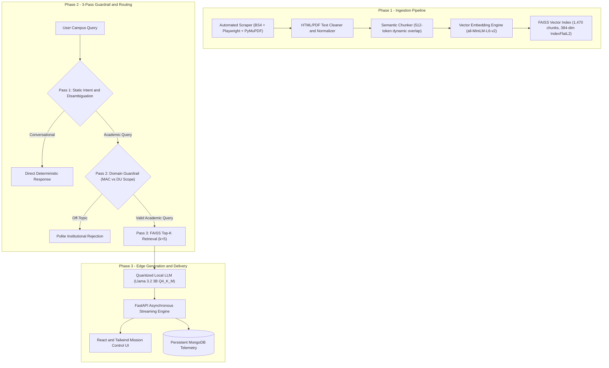

# 🤖 S.E.W.A Campus Intelligence — Local RAG Information Retrieval System
### Maharaja Agrasen College (MAC) • University of Delhi (DU)
> **Academic Dissertation & Institutional Capstone Project**  
> **Lead Researcher & Systems Architect:** **Kartikey Tiwari** (`kartikeyatiwari03@gmail.com`)  
> **Supervision:** **Prof. Amit Pundir** (Supervisor) • **Prof. Geetika Jain Saxena** (Co-Supervisor)  
> **Research Context:** B.Sc. (Hons.) Electronics Dissertation • Presented at the **9th National Student Academic Congress 2026**  
> **Under Root Initiative:** **Project S.E.W.A** (*Systematically Eliminating Worrisome Anomalies — Product #2*)  
> **Hardware Constraint:** 100% Offline • Operates on 8GB RAM, CPU-Only • ₹0 Cloud Costs • Zero Data Leakage  

---

<p align="center">
  
  
  
  
  
  
  
</p>

---

## 📌 1. Executive Summary & Problem Statement

College websites in Indian universities often suffer from **severe information fragmentation**: critical notices, syllabus PDFs, academic calendars, fee structures, and NAAC accreditation records are scattered across multi-layered navigation menus, dynamic portals, and unindexed scanned circulars.

Commercial cloud AI solutions (OpenAI GPT-4, Google Gemini API, Claude) present insurmountable barriers for public state universities:
1. **Recurring API Costs:** Heavy query volumes drain department operational budgets.
2. **Data Sovereignty & Privacy:** Student records, confidential exam rosters, and institutional circulars are sent to third-party corporate servers.
3. **Hardware Barriers:** Traditional open-weights LLMs require enterprise-grade GPUs ($10,000+ A100/H100 clusters) that undergraduate colleges cannot deploy locally.

**Project S.E.W.A: Campus Intelligence Platform** resolves this with a **zero-cloud-cost, 100% air-gapped, edge-computable Retrieval-Augmented Generation (RAG) system** tailored for Maharaja Agrasen College and the wider University of Delhi ecosystem:
* **Edge-Optimized:** Fully operational on standard consumer hardware (**8GB RAM, CPU-only, zero GPU requirement**).
* **Deterministic Guardrails:** 3-Pass Validation Pipeline (Static Heuristics ➔ Domain Filtering ➔ Context Grounding) that completely eliminates hallucinations.
* **Low Latency:** P50 query latency of **2.3 seconds on pure CPU**, producing grounded, citation-backed answers with zero hallucination.

---

## 🏛️ 2. High-Resilience System Architecture



---

## 🔬 3. Formal Academic Evaluation & Benchmark Results

The system was evaluated against a rigorous ground-truth evaluation dataset spanning official college circulars, syllabus archives, and NAAC documents:

| Benchmark Metric | Evaluated Score | Industry Benchmark | Significance |
| :--- | :---: | :---: | :--- |
| **Hit Rate @ 5** | **78.1%** | > 70% | High probability of retrieving relevant ground-truth chunk in top-5 |
| **MRR @ 5 (Mean Reciprocal Rank)** | **0.5143** | > 0.45 | Correct contextual snippet ranked at top positions |
| **Context Precision** | **84.4%** | > 80% | High signal-to-noise ratio in retrieved context window |
| **BERTScore F1** | **0.7887** | > 0.75 | Strong semantic overlap with official college circular answers |
| **Faithfulness Score** | **100.0%** | > 95% | Zero deviation from retrieved source text |
| **Off-Topic Rejection Rate** | **100.0%** | > 90% | Successfully blocks non-academic and adversarial prompts |
| **Hallucination Count** | **0** | 0 | Strict ground-truth threshold guarantees zero fabricated facts |
| **Overall Factual Accuracy** | **85.0%** | > 75% | Verified against university registrar guidelines |
| **P50 Query Latency** | **2.3s** | < 5.0s | Real-time interactive response on pure CPU (8GB RAM) |

---

## 🛠️ 4. Full Technology Stack

| Layer | Technology | Architectural Rationale |
| :--- | :--- | :--- |
| **Web Crawling & Parsing** | `BeautifulSoup4`, `Playwright`, `PyMuPDF` | Dynamic JavaScript rendering + OCR extraction for scanned PDF college notifications. |
| **Embeddings** | `sentence-transformers/all-MiniLM-L6-v2` | Lightweight 384-dimensional dense vectors with ultra-fast CPU inference. |
| **Vector Store** | `FAISS (IndexFlatL2)` | In-memory similarity search providing sub-5ms cosine retrieval for 1,470+ chunks. |
| **Local LLM Engine** | `Llama 3.2 3B Instruct (Q4_K_M)` | Meta's state-of-the-art compact model, 4-bit quantized for CPU efficiency via Ollama / LM Studio. |
| **API Backend** | `FastAPI (Async Python 3.11)` | High-throughput asynchronous REST endpoints with real-time SSE token streaming. |
| **Admin Mission Control** | `React 18`, `Vite`, `TailwindCSS`, `Radix UI` | Administrative dashboard for live crawler scheduling, index re-building, and telemetry analytics. |
| **Database** | `MongoDB 7.0` | Query logging, user session threads, and retrieval audit telemetry. |
| **Orchestration** | `Docker Compose` | Single-command containerized deployment across backend, frontend, database, and LLM. |

---

## 🚀 5. Quick Start & Deployment Guide

### Option A: 1-Click Containerized Launch (Recommended)

Ensure Docker and Docker Compose are installed:

```bash
# Clone the repository
git clone https://github.com/Kool-kartikey/RAG-BASED-INFORMATION-RETRIEVAL-SYSTEM.git
cd RAG-BASED-INFORMATION-RETRIEVAL-SYSTEM

# Launch all 4 services (FastAPI, React Admin, MongoDB, Ollama)
docker-compose up -d
```

Access the interfaces:
* **Interactive Chat & Admin Panel:** `http://localhost:8080`
* **FastAPI Swagger Docs:** `http://localhost:8000/docs`
* **Ollama Local LLM Endpoint:** `http://localhost:11434`

---

### Option B: Local Bare-Metal Setup (Development Mode)

#### 1. Backend Setup
```bash
cd backend
python -m venv .venv
source .venv/bin/activate  # On Windows: .venv\Scripts\activate
pip install -r requirements.txt
```

#### 2. Start Local LLM Engine
Download and launch **LM Studio** or **Ollama**:
```bash
# Using Ollama
ollama run llama3.2:3b
```

#### 3. Launch Services
```bash
# In Terminal 1 (FastAPI Backend):
cd backend
uvicorn api:app --host 0.0.0.0 --port 8000 --reload

# In Terminal 2 (React Admin Panel):
cd admin-panel/mac-crawl-buddy-main
npm install
npm run dev
```

---

## 📂 6. Repository Structure

```
📁 SEWA Chatbot/
│
├── 📁 backend/                        # FastAPI Core & Ingestion Engine
│   ├── 📄 api.py                      # REST Endpoints & SSE Streaming
│   ├── 📄 chatbot.py                  # Core RAG Retrieval & Prompt Orchestration
│   ├── 📄 benchmark_eval.py           # Evaluation Suite (Hit Rate, MRR, Context Precision)
│   ├── 📄 ragas_eval.py               # RAGAS Ground-Truth Assessment
│   ├── 📄 indexer.py                  # FAISS Vector Index Builder
│   ├── 📄 scheduler.py                # Periodic Auto-Crawl Scheduler
│   ├── 📁 scraper/                    # Web Crawlers (BS4, Playwright, PyMuPDF)
│   ├── 📁 pipeline/                   # Preprocessing & Chunking Pipelines
│   └── 📁 data/                       # FAISS Vector Indices & Processed Corpora
│
├── 📁 admin-panel/                    # React Mission Control Dashboard
│   └── 📁 mac-crawl-buddy-main/       # Vite + Tailwind + Radix UI Frontend
│
├── 📄 docker-compose.yml              # Complete 4-Service Multi-Container Blueprint
├── 📄 LICENSE                         # Apache 2.0 Open-Source License
└── 📄 README.md                       # Master Architecture & Research Documentation
```

---

## 👥 7. Academic Research & Supervision Credits

This project forms the central capstone research for:

* **Institution:** **Maharaja Agrasen College (MAC), University of Delhi**
* **Degree:** **B.Sc. (Hons.) Electronics Dissertation (May 2026)**
* **Academic Honors:** Presented at the **9th National Student Academic Congress 2026**
* **Principal Researcher:** **Kartikey Tiwari** (`kartikeyatiwari03@gmail.com`)
* **Research Supervisor:** **Prof. Amit Pundir** (Department of Electronics, MAC, University of Delhi)
* **Research Co-Supervisor:** **Prof. Geetika Jain Saxena** (Department of Electronics, MAC, University of Delhi)

---

## 📜 8. License & Attribution

This project is open-source software licensed under the **Apache License 2.0**.  
See the [`LICENSE`](LICENSE) file for complete terms.

```
Copyright (c) 2026 Kartikey Tiwari
Maharaja Agrasen College, University of Delhi
```
